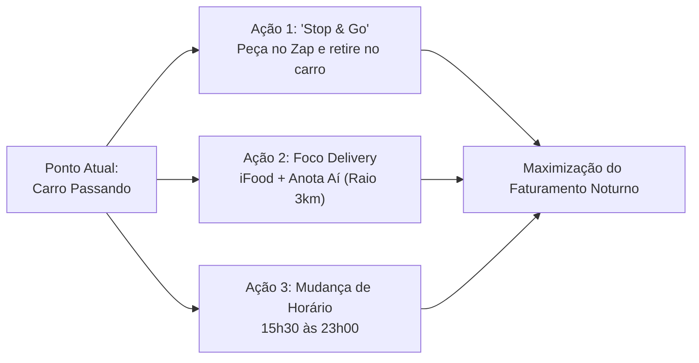

# Estudo de Mercado, Geomarketing e Viabilidade Operacional
## Claem Pastelaria — Rua Antônio Prado, 04 (esq. Visconde de Pelotas), Bairro Exposição — Caxias do Sul / RS

---

## 1. Sumário Executivo & Diagnóstico do Ponto

A **Claem Pastelaria** opera em um ponto geográfico muito específico de Caxias do Sul: a confluência da **Rua Visconde de Pelotas** (uma das principais artérias viárias de escoamento da cidade) com a **Rua Antônio Prado**, no coração do **Bairro Exposição**, a poucos metros do **Parque dos Macaquinhos (Parque Getúlio Vargas)**.

```
       [Centro / Fluxo Comercial]
                   ↓ (Rua Visconde de Pelotas - Trânsito Contínuo)
    ═══════════════════════════════════════════════
                 [CLAEM PASTELARIA]  ← Esquina com Rua Antônio Prado
    ═══════════════════════════════════════════════
                   ↓ (Sentido Sul / Saída de Bairros)
     [Parque dos Macaquinhos]  &  [Área Residencial Nobre - Exposição]
```

### O Desafio Central: Descompasso entre Ponto e Modelo Operacional
1. **Via de Passagem x Balcão Espontâneo:** A Visconde de Pelotas é uma via de tráfego fluido de veículos. Não há calçadão nem fluxo denso de pedestres como na Av. Júlio de Castilhos ou Rua Marechal Floriano. 
2. **Fricção de Parada (Estacionamento):** Para um motorista parar e comer no balcão, ele precisa encontrar vaga, manobrar e pagar Área Azul/estacionamento. Para um ticket de R$ 15 a R$ 25 de pastel, a taxa de atrito é muito alta.
3. **Hábito Matinal Gaúcho:** O morador de Caxias do Sul não tem o hábito de consumir pastel frito e refrigerante/caldo de cana entre 08h e 11h. A manhã pertence às padarias e cafeterias (café colonial, pão de queijo, pão na chapa). 
4. **O "Sangramento" do Turno da Manhã:** Manter fritadeiras aquecidas, exaustores ligados, luz e funcionários escalados das 08h às 14h sem volume de pedidos gera prejuízo operacional diário que corrói o lucro da noite.

---

## 2. Benchmark de Mercado em Caxias do Sul

Analisando as pastelarias e operações consolidadas da cidade (Hora do Pastel, Dileta, Pastel Zone, Delvi's, Tedy), observa-se um padrão claro de funcionamento:

| Estabelecimento | Localização | Perfil do Ponto | Horário Praticado | Estratégia Principal |
| :--- | :--- | :--- | :--- | :--- |
| **Hora do Pastel** | Rua Mal. Floriano, Centro | Altíssimo fluxo a pé | Seg a Sáb: 10h30 às 23h<br>Dom: 17h às 23h | Presencial de almoço + Salão + Delivery noturno |
| **Dileta Pastelaria** | Periferia / BR-116 | Trânsito rodoviário/bairro | Ter a Sáb: 11h-14h e 17h-23h<br>Seg e Dom: 17h-23h | **Dois turnos ou apenas noturno** |
| **Pastel Zone** | Bairro Eldorado | Residencial | 08h30 às 22h | Delivery pesado + lanche local |
| **Delvi's / Tedy** | Diversos pontos | Bairro / Delivery | 16h30 / 17h00 às 23h | Foco total em Delivery e Jantar |

> **Conclusão de Mercado:** Nenhuma pastelaria com perfil de rua ou de bairro opera focando em presencial antes das 11h da manhã. As operações lucrativas concentram 70% a 85% do faturamento no período entre **17h00 e 23h00**.

---

## 3. Análise Demográfica e Geomarketing do Bairro Exposição

* **Renda Domiciliar:** O Bairro Exposição está entre os 3 bairros com maior renda média per capita de Caxias do Sul.
* **Perfil dos Moradores:** Famílias, casais sem filhos e profissionais liberais residentes em edifícios verticais de médio-alto e alto padrão.
* **Oportunidade Perdida:** Esse público **não busca preço baixo; busca comodidade, recheio generoso e rapidez**. Tentar vender pastel barato no balcão pela manhã subutiliza o poder de compra da região.
* **Polo Gerador Noturno (Parque dos Macaquinhos):** Nos fins de tarde ensolarados ou amenos, centenas de pessoas circulam na área. Na saída, procuram lanches práticos para levar para casa.

---

## 4. Comparativo Financeiro dos Cenários Operacionais

### Cenário A: Modelo Atual (08h às 21h — 13 horas ininterruptas)
* **Escala de Pessoal:** Exige 2 turnos de equipe ou horas extras elevadas.
* **Consumo Energético:** Fritadeira elétrica/gás ligada por 13 horas contínuas.
* **Curva de Receita Estimada:**
  * 08h às 11h30: ~10% do faturamento (custo operacional maior que o faturamento).
  * 11h30 às 14h00: ~25% do faturamento (competindo com bufês a quilo e marmitas).
  * 14h00 às 17h00: ~15% do faturamento (vale da tarde).
  * 17h00 às 21h00: ~50% do faturamento (corta no melhor momento do jantar).

### Cenário B: Turno Otimizado Tarde/Noite (15h30 às 23h00 — 7h30 de operação)
* **Escala de Pessoal:** 1 único turno enxuto, motivado e focado.
* **Economia Fixa:** Redução de 35% a 45% nos custos com energia/gás e eliminação de sobrecarga de folha.
* **Captura do Pico Real de Delivery:** Estende o fechamento das 21h para 23h — justamente a janela em que casais e famílias no Exposição, Centro e Panazzolo pedem delivery.

---

## 5. Plano de Transformação Comercial da Claem



### Pilar 1: Criar o "Stop & Go" (Retirada no Carro na Antônio Prado)
Como a esquina da Antônio Prado é menos veloz que a Visconde de Pelotas, o cliente pode estacionar por 2 minutos para retirada rápida:
1. **Comunicação na Fachada:** Placa de leitura dinâmica para o motorista que desce a Visconde: *"Pastel Quentinho na Volta pra Casa. Peça pelo WhatsApp e Retire no Carro sem Descer"*.
2. **Cardápio Digital com Agendamento:** O motorista que sai do trabalho no Centro às 18h15 pede via WhatsApp; o pastel fica pronto às 18h30 exatas; ele para na Antônio Prado, o atendente entrega a sacola no vidro do carro.

### Pilar 2: Reestruturação do Cardápio para o Bairro Exposição
* **Combos Família (Aumentar Ticket Médio):**
  * *Combo Noite do Pastel:* 4 pastéis grandes + 1 doce + Refrigerante 2L por valor fixo.
  * O público do Exposição compra para o jantar da família inteira, elevando o ticket de R$ 20 para R$ 75+.
* **Pastéis Premium / Identidade Regional:** 
  * Sabores de alto valor agregado: Costela desfiada com queijo colonial, Quatro Queijos da Serra, Strogonoff de Filé, Chocolate com Morango.

### Pilar 3: Presença Agressiva no Delivery (iFood e Próprio)
* Raio prioritário de entrega rápida (até 15 minutos): Bairros Exposição, Centro, Panazzolo, Cristo Redentor, Lourdes, Pio X.
* Embalagens especiais térmicas respiráveis (evitar que o pastel chegue murcho pelo vapor).

---

## 6. Roteiro de Implementação em 30 Dias

| Semana | Ações Práticas |
| :--- | :--- |
| **Semana 1** | **Medição Interna:** Planilhar vendas das 08h às 14h vs. 17h às 21h para tangibilizar o prejuízo do turno da manhã para as proprietárias. |
| **Semana 2** | **Ajuste de Horário:** Alterar funcionamento para **15h30 às 22h30 (ou 23h sex/sáb)**. Divulgar em cartazes físicos, Google Meu Negócio e Instagram. |
| **Semana 3** | **Lançamento do "Stop & Go":** Implantar cardápio digital (WhatsApp) com opção clara "Retirada no Carro na Antônio Prado". |
| **Semana 4** | **Campanha de Delivery Noturno:** Fazer promoções de combos no iFood no horário das 18h às 22h para alavancar a classificação no algoritmo local. |

